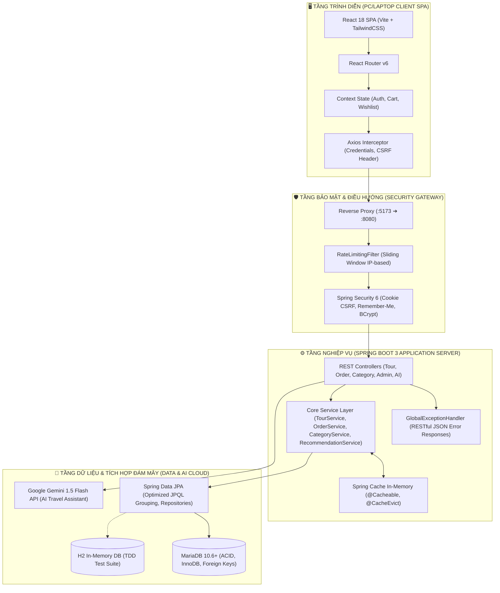
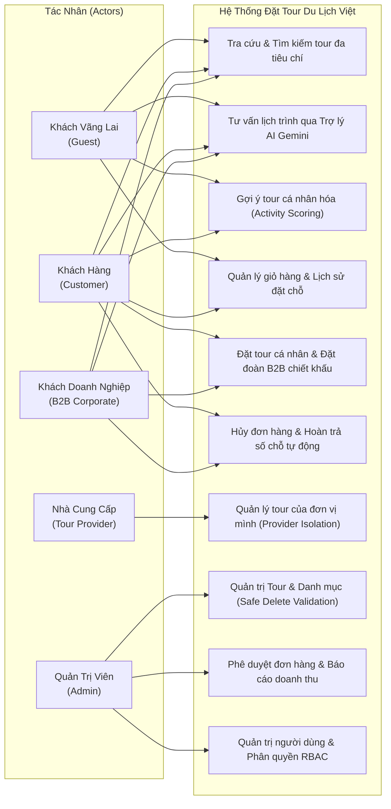
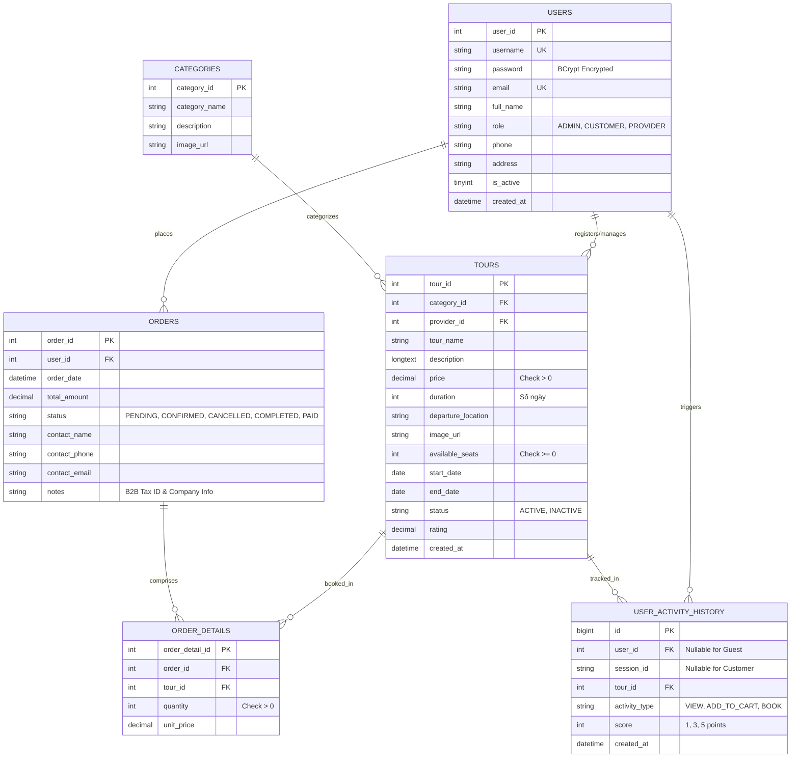
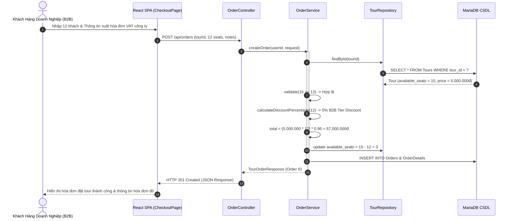
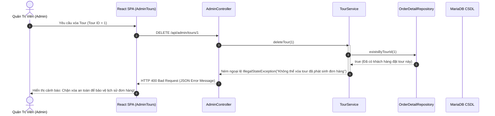
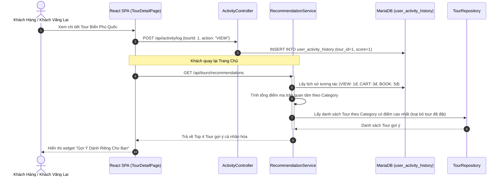
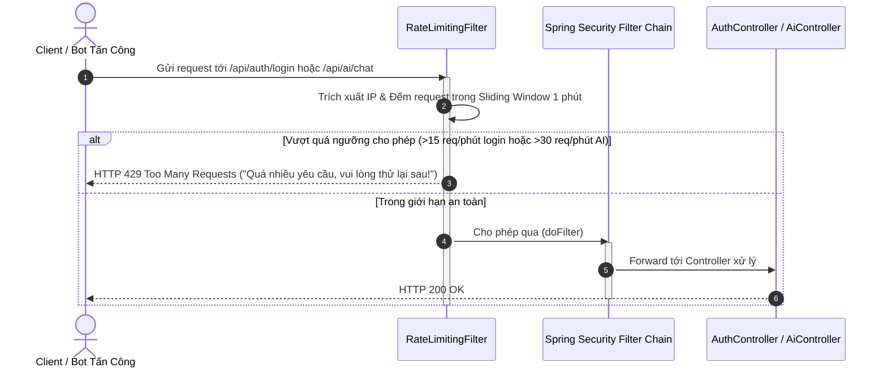

# 🌴 Du Lịch Việt (TourBooking Platform)
### Hệ Thống Giới Thiệu & Đăng Ký Tour Du Lịch Trực Tuyến Tối Ưu Cho PC/Laptop Tích Hợp Trợ Lý Ảo Du Lịch AI

<p align="center">
  
</p>

<p align="center">
  <a href="#-công-nghệ-sử-dụng"></a>
  <a href="#-công-nghệ-sử-dụng"></a>
  <a href="#-công-nghệ-sử-dụng"></a>
  <a href="#-công-nghệ-sử-dụng"></a>
  <a href="#-công-nghệ-sử-dụng"></a>
  <a href="#-công-nghệ-sử-dụng"></a>
  <a href="#-công-nghệ-sử-dụng"></a>
  <a href="#-công-nghệ-sử-dụng"></a>
  <a href="#-10-kiến-trúc-kỹ-nghệ-nâng-cao-tối-ưu-hiệu-năng--bộ-kiểm-thử-tdd"></a>
  <a href="#-10-kiến-trúc-kỹ-nghệ-nâng-cao-tối-ưu-hiệu-năng--bộ-kiểm-thử-tdd"></a>
  <a href="#-giấy-phép"></a>
</p>

---

## 📌 Thông Tin Đề Tài & Học Phần
* **Học phần**: Lập Trình WWW (Java)
* **Đề tài**: **Đề tài số 49 — Website giới thiệu tour du lịch và cho phép đăng ký tour trực tuyến**
* **Đơn vị đào tạo**: Khoa Công nghệ Thông tin — Trường Đại học Công nghiệp TP. Hồ Chí Minh (IUH)
* **Giảng viên hướng dẫn**: **ThS. Nguyễn Vũ Lâm**
* **Nhóm thực hiện**: **Nhóm 5 (Lớp DHKTPM19ATT)**
* **Tài liệu báo cáo chi tiết**: [`docs/Nhom5_Detai49_BaoCaoCuoiKy.docx`](docs/Nhom5_Detai49_BaoCaoCuoiKy.docx) (Chuẩn format Khóa luận tốt nghiệp IUH)
* **Tài liệu đặc tả kiến trúc & chức năng (SRS & UML)**: [`docs/DACTAC_KIENTRUC_VA_CHUNANG.md`](docs/DACTAC_KIENTRUC_VA_CHUNANG.md) (Đặc tả chi tiết Use Case, ERD, Sequence, RBAC, Safe Delete)

---

## 📖 Mục Lục
- [1. Giới Thiệu Tổng Quan](#-1-giới-thiệu-tổng-quan)
- [2. Điểm Khác Biệt & Tối Ưu Cho Web Desktop (PC/Laptop)](#-2-điểm-khác-biệt--tối-ưu-cho-web-desktop-pclaptop)
- [3. Tính Năng Nổi Bật](#-3-tính-năng-nổi-bật)
- [4. Kiến Trúc Hệ Thống & Đặc Tả Thiết Kế UML](#-4-kiến-trúc-hệ-thống--đặc-tả-thiết-kế-uml)
- [5. Cấu Trúc Thư Mục Dự Án](#-5-cấu-trúc-thư-mục-dự-án)
- [6. Hướng Dẫn Cài Đặt & Khởi Chạy Nhanh](#-6-hướng-dẫn-cài-đặt--khởi-chạy-nhanh)
- [7. Danh Sách Tài Khoản Trải Nghiệm (Demo Accounts)](#-7-danh-sách-tài-khoản-trải-nghiệm-demo-accounts)
- [8. Danh Mục REST API Cốt Lõi](#-8-danh-mục-rest-api-cốt-lõi)
- [9. Kịch Bản Kiểm Thử & Kiểm Soát Ràng Buộc (Safe Delete)](#-9-kịch-bản-kiểm-thử--kiểm-soát-ràng-buộc-safe-delete)
- [10. Kiến Trúc Kỹ Nghệ Nâng Cao, Tối Ưu Hiệu Năng & Bộ Kiểm Thử TDD](#-10-kiến-trúc-kỹ-nghệ-nâng-cao-tối-ưu-hiệu-năng--bộ-kiểm-thử-tdd)
- [11. Thành Viên Nhóm Thực Hiện](#-11-thành-viên-nhóm-thực-hiện)

---

## 🌟 1. Giới Thiệu Tổng Quan

**Du Lịch Việt (TourBooking)** là giải pháp chuyển đổi số toàn diện cho ngành dịch vụ lữ hành, kết nối liền mạch giữa:
1. **Khách hàng cá nhân & Doanh nghiệp**: Dễ dàng tra cứu thông tin, so sánh hành trình, quản lý giỏ hàng, nhận gợi ý tour thông minh và đặt tour đoàn B2B với chiết khấu bậc thang.
2. **Nhà cung cấp dịch vụ (Tour Providers)**: Quản lý danh mục tour, quản lý lịch khởi hành và điều phối số chỗ.
3. **Đội ngũ Quản trị viên (Admin)**: Kiểm soát an toàn dữ liệu, phê duyệt đơn hàng, theo dõi báo cáo doanh thu đa trạng thái (`PAID`, `CONFIRMED`, `COMPLETED`) và tương tác an toàn với cơ sở dữ liệu.

---

## 💻 2. Điểm Khác Biệt & Tối Ưu Cho Web Desktop (PC/Laptop)

Không giống các ứng dụng di động bị giới hạn bởi không gian hiển thị nhỏ, hệ thống **Du Lịch Việt** được thiết kế chuyên biệt để phát huy tối đa sức mạnh của **máy tính cá nhân (PC / Laptop màn hình lớn từ 1366x768 đến 1920x1080 Full HD)**:

* 🖥️ **Không gian bố cục đa cột (Multi-column Dashboard)**: Xem đồng thời chi tiết tour, hành trình theo ngày dạng timeline tương tác, bảng giá chi tiết kèm dịch vụ bao gồm/loại trừ mà không phải cuộn trang liên tục.
* 👥 **Xử lý Đơn hàng Doanh nghiệp & Đoàn đông (B2B)**: Giao diện nhập liệu danh sách thành viên đoàn, áp dụng thuật toán chiết khấu tự động theo bậc số lượng khách và xuất hóa đơn giá trị gia tăng (VAT).
* 🛒 **Giỏ hàng Session & Đa nhiệm**: Lưu trữ giỏ hàng trong biến phiên `HttpSession`, cho phép khách hàng vừa so sánh tour, vừa tham khảo ý kiến gia đình/đồng nghiệp trước khi chốt thanh toán.
* 📊 **Trang Quản trị Đa Nhiệm (Split-view Admin Portal)**: Giúp nhân viên điều hành tour đối soát danh sách khách, kiểm tra tồn chỗ và xuất dữ liệu chỉ trong một màn hình thao tác.

---

## 🚀 3. Tính Năng Nổi Bật

### 🧑‍💼 Dành cho Khách Hàng (Customer & Guest)
* **Khám phá & Bộ lọc Đa tiêu chí**: Lọc tour theo danh mục, điểm khởi hành, khoảng giá (slider), thời lượng (ngày/đêm) và tìm kiếm từ khóa tức thì.
* **Hành trình Tour Sinh động**: Hiển thị lịch trình chi tiết theo từng ngày (Day-by-day Itinerary), chính sách hoàn hủy và danh sách dịch vụ đi kèm.
* **Cá nhân hóa Gợi ý (Smart Recommendations)**: Lưu vết lịch sử xem tour và hành vi tìm kiếm (`UserActivityHistory`) để đề xuất các tour có cùng vùng miền hoặc khoảng giá phù hợp.
* **Trợ lý Ảo Du Lịch AI (Google Gemini 1.5 Integration)**: Widget AI Chat tương tác nổi ở góc màn hình, giải đáp thắc mắc về điểm đến, thời tiết, trang phục chuẩn bị và gợi ý lịch trình 24/7.
* **Thanh toán & Xuất vé Điện tử**: Giả lập cổng thanh toán trực tuyến an toàn, quản lý trạng thái đơn hàng (`PENDING`, `PAID`, `CONFIRMED`, `CANCELLED`).

### 🏢 Dành cho Đặt Tour Doanh Nghiệp (B2B)
* **Chiết khấu Bậc thang Tự động**:
  * Đặt từ 10 - 19 khách: Chiết khấu ngay **5%**.
  * Đặt từ 20 khách trở lên: Chiết khấu ngay **10%**.
* **Xuất Hóa đơn GTGT (VAT Invoice)**: Nhập thông tin tên doanh nghiệp, mã số thuế và địa chỉ xuất hóa đơn trực tiếp khi tạo đơn.

### 🛡️ Dành cho Quản Trị Viên & Đối Tác (Admin & Provider)
* **Dashboard Thống kê Thời gian thực**: Biểu đồ doanh thu thực tế, tổng số đơn đặt, tỷ lệ lấp đầy chỗ của các tour đang chạy.
* **Quản lý Tour & Danh mục Toàn diện**: Thêm, sửa, đóng lịch tour, upload ảnh và chỉnh sửa lịch trình linh hoạt.
* **Cơ chế Safe Delete (Xóa An Toàn Tuyệt Đối)**:
  * Chặn xóa Danh mục đang có tour trực thuộc.
  * Chặn xóa Tour đã có đơn hàng của khách.
  * Chặn xóa Tài khoản đối tác còn tour đang mở bán; chặn xóa Khách hàng đã phát sinh lịch sử giao dịch.
  * Tự động dọn dẹp các bản ghi liên kết phụ thuộc (`UserActivityHistory`) trước khi xóa để loại trừ 100% lỗi vi phạm khóa ngoại Foreign Key MariaDB.

---

## 🏗️ 4. Kiến Trúc Hệ Thống & Đặc Tả Thiết Kế UML

> 📖 *Tham khảo tài liệu phân tích thiết kế chi tiết: [`docs/DACTAC_KIENTRUC_VA_CHUNANG.md`](docs/DACTAC_KIENTRUC_VA_CHUNANG.md)*

### 4.1. Sơ Đồ Kiến Trúc Hệ Thống 3 Tầng (3-Tier Enterprise Architecture)


### 4.2. Sơ Đồ Ca Sử Dụng Tổng Quát (Use Case Diagram)


### 4.3. Sơ Đồ Thực Thể Quan Hệ (Entity-Relationship Diagram - ERD)


### 4.4. Các Sơ Đồ Tuần Tự Nghiệp Vụ Trọng Điểm (Sequence Diagrams)

#### 1. Đặt Tour Đoàn B2B & Chiết Khấu Bậc Thang Tự Động


#### 2. Cơ Chế Kiểm Soát Ràng Buộc Xóa An Toàn (Safe Delete)


#### 3. Gợi Ý Tour Cá Nhân Hóa Dựa Trên Lịch Sử Hoạt Động


#### 4. Bảo Mật Phòng Thủ Đa Tầng & Giới Hạn Tần Suất (Rate Limiter)


### 4.5. Ma Trận Phân Quyền Hệ Thống (RBAC Matrix)

| Quyền Hạn & Tính Năng | Khách Vãng Lai (Guest) | Khách Hàng (Customer) | Khách Doanh Nghiệp (B2B) | Nhà Cung Cấp (Provider) | Quản Trị Viên (Admin) |
| :--- | :---: | :---: | :---: | :---: | :---: |
| **Xem Danh sách & Chi tiết Tour** | ✅ | ✅ | ✅ | ✅ | ✅ |
| **Tìm kiếm & Bộ lọc Đa tiêu chí** | ✅ | ✅ | ✅ | ✅ | ✅ |
| **Chat Tư Vấn với Trợ Lý AI Gemini** | ✅ (30 req/phút) | ✅ (30 req/phút) | ✅ (30 req/phút) | ✅ (30 req/phút) | ✅ Không giới hạn |
| **Giỏ Hàng & Lịch Sử Tương Tác** | ✅ (Session) | ✅ (Database) | ✅ (Database) | ❌ | ❌ |
| **Gợi Ý Tour Cá Nhân Hóa** | ✅ (Session Tracking) | ✅ (User Scoring) | ✅ (User Scoring) | ❌ | ❌ |
| **Đặt Tour Cá Nhân Trực Tuyến** | ❌ (Yêu cầu login) | ✅ | ✅ | ❌ | ❌ |
| **Đặt Tour Đoàn B2B (Chiết khấu 5% - 10%)** | ❌ | ❌ (< 10 khách) | ✅ ($\ge 10$ khách) | ❌ | ❌ |
| **Quản Lý & Hủy Đơn Hàng Của Mình** | ❌ | ✅ Đơn của mình | ✅ Đơn của mình | ❌ | ✅ Toàn bộ đơn |
| **Đăng Ký & Quản Lý Tour Riêng** | ❌ | ❌ | ❌ | ✅ Tour của mình | ✅ Toàn bộ tour |
| **Xóa Tour (Kiểm tra Safe Delete)** | ❌ | ❌ | ❌ | ✅ Tour chưa có đơn | ✅ Tour chưa có đơn |
| **Quản Trị Danh Mục & Safe Delete** | ❌ | ❌ | ❌ | ❌ | ✅ Toàn quyền |
| **Quản Trị Tài Khoản Người Dùng** | ❌ | ❌ | ❌ | ❌ | ✅ Toàn quyền |
| **Xem Báo Cáo Doanh Thu Đa Trạng Thái** | ❌ | ❌ | ❌ | ❌ | ✅ Toàn quyền |

### 4.6. Bảng Công Nghệ Cốt Lõi
| Tầng Kiến Trúc | Công Nghệ Lựa Chọn | Phiên Bản | Vai Trò & Điểm Mạnh |
| :--- | :--- | :--- | :--- |
| **Backend Core** | Java JDK | 17 LTS | Nền tảng hướng đối tượng mạnh mẽ, Record types, Pattern matching |
| **Framework** | Spring Boot | 3.5.6 | Framework chuẩn doanh nghiệp, tích hợp sẵn Embedded Tomcat |
| **Bảo Mật** | Spring Security | 6.x | Kiểm soát phân quyền Role-based, cấu hình CSRF Cookie, mã hóa BCrypt |
| **ORM / Data** | Spring Data JPA / Hibernate | 6.x | Quản lý quan hệ thực thể, JPQL, Transaction `@Transactional` nguyên tử |
| **Cơ Sở Dữ Liệu** | MariaDB Server | 10.6+ | Hệ quản trị CSDL quan hệ tốc độ cao, hỗ trợ chuẩn ACID |
| **Frontend Core** | React JS | 18.2 | Xây dựng Single Page Application (SPA), State Contexts linh hoạt |
| **Build Tool FE** | Vite | 5.x | Tốc độ biên dịch siêu tốc, Hot Module Replacement (HMR) tức thì |
| **Kiểm Thử** | JUnit 5 + Mockito + H2 DB | 5.10 | Bộ kiểm thử tự động khép kín theo mô hình TDD (15/15 tests pass) |
| **Trí Tuệ Nhân Tạo** | Google Gemini API | 1.5 Flash | Mô hình ngôn ngữ lớn (LLM) hỗ trợ tư vấn và gợi ý du lịch thông minh |

---

## 📁 5. Cấu Trúc Thư Mục Dự Án

```text
JavaWWW_Nhom5_TourBooking/
├── backend/                               # Mã nguồn Backend Java Spring Boot
│   ├── src/main/java/vn/dulichviet/tourbooking/
│   │   ├── config/                        # Cấu hình Security, UserDetails, DataInitializer
│   │   ├── controller/                    # REST Controllers (Auth, Tour, Order, Admin, AI)
│   │   ├── dto/                           # Data Transfer Objects (Requests, Responses)
│   │   ├── entity/                        # Các Entity JPA (User, Tour, Category, TourOrder,...)
│   │   ├── exception/                     # Xử lý ngoại lệ toàn cục GlobalExceptionHandler
│   │   ├── repository/                    # Giao diện Spring Data JPA Repositories
│   │   ├── service/                       # Tầng nghiệp vụ xử lý logic và tính toán
│   │   └── TourBookingApplication.java    # Lớp khởi chạy chính của Spring Boot
│   ├── src/main/resources/
│   │   └── application.properties         # Cấu hình kết nối CSDL, cổng server, Gemini Key
│   ├── build.gradle                       # Tệp cấu hình thư viện và build Gradle
│   └── gradlew.bat                        # Gradle Wrapper thực thi trên Windows
├── database/                              # Kịch bản cơ sở dữ liệu
│   ├── schema.sql                         # Khởi tạo bảng, khóa ngoại, chỉ mục (Index)
│   ├── data.sql                           # Nạp dữ liệu mẫu hoàn chỉnh (Users, Tours, Orders)
│   └── seed_vi.sql                        # Dữ liệu tour du lịch Việt Nam mở rộng
├── docs/                                  # Tài liệu báo cáo chính thức
│   ├── Nhom5_Detai49_BaoCaoCuoiKy.docx    # Báo cáo chuẩn Khóa luận tốt nghiệp IUH (14.000 từ)
│   ├── 23637711_DangkyDetai.docx          # Phiếu đăng ký đề tài chính thức
│   └── YeuCau_BaiTap_Nhom_...docx         # Đặc tả yêu cầu môn học của giảng viên
├── src/                                   # Mã nguồn Frontend React SPA
│   ├── api/                               # Cấu hình Axios Interceptors, CSRF & Bearer Tokens
│   ├── components/                        # UI Components (Header, Footer, TourCard, AiChatWidget)
│   ├── context/                           # React Context (AuthContext, CartContext, Wishlist)
│   ├── pages/                             # Các trang giao diện (Home, Detail, Checkout, Admin,...)
│   ├── App.jsx                            # Điều hướng Route chính
│   └── main.jsx                           # Điểm nhập React DOM
├── package.json                           # Cấu hình phụ thuộc Node.js & Vite
├── vite.config.ts                         # Cấu hình Vite Dev Server & Reverse Proxy
└── README.md                              # Tài liệu hướng dẫn dự án chuẩn GitHub
```

---

## ⚡ 6. Hướng Dẫn Cài Đặt & Khởi Chạy Nhanh

### Yêu Cầu Môi Trường
* **Hệ điều hành**: Windows 10/11, macOS hoặc Ubuntu Linux.
* **Java**: OpenJDK 17 trở lên.
* **Node.js**: Phiên bản 18 LTS hoặc 20 LTS.
* **Cơ sở dữ liệu**: MariaDB 10.6+ hoặc MySQL 8.0+.
* **Công cụ hỗ trợ (tùy chọn)**: HeidiSQL, DBeaver hoặc MySQL Workbench.

---

### Bước 1: Khởi Tạo Cơ Sở Dữ Liệu
1. Mở công cụ quản lý CSDL (như HeidiSQL hoặc DBeaver), kết nối tới MariaDB/MySQL server tại `127.0.0.1:3306`.
2. Mở và thực thi tệp [`database/schema.sql`](database/schema.sql) để tạo database `TourBookingDB` cùng các bảng quan hệ.
3. Mở và thực thi tệp [`database/data.sql`](database/data.sql) để nạp đầy đủ danh mục, danh sách tour, lịch sử tương tác và các tài khoản demo.

---

### Bước 2: Khởi Chạy Backend (Spring Boot API)
1. Mở cửa sổ dòng lệnh PowerShell tại thư mục gốc của dự án.
2. Di chuyển vào thư mục `backend`:
   ```powershell
   cd backend
   ```
3. Kiểm tra thông tin kết nối trong `src/main/resources/application.properties` (Mặc định: User `root`, Password trống). Bạn có thể truyền mật khẩu qua biến môi trường nếu CSDL của bạn có mật khẩu:
   ```powershell
   $env:DB_PASSWORD="your_password"
   ```
4. *(Tùy chọn)* Cấu hình Google Gemini API Key để kích hoạt Trợ lý ảo AI:
   ```powershell
   $env:GEMINI_API_KEY="AIzaSyYourGeminiApiKeyHere"
   ```
5. Chạy dự án bằng Gradle Wrapper:
   ```powershell
   .\gradlew.bat bootRun
   ```
6. Backend sẽ khởi chạy tại: `http://localhost:8080`.

---

### Bước 3: Khởi Chạy Frontend (React SPA)
1. Mở thêm một cửa sổ terminal mới tại thư mục gốc dự án:
   ```powershell
   npm install
   npm run dev
   ```
2. Truy cập ứng dụng trực tiếp trên trình duyệt Web PC/Laptop tại:
   👉 **`http://localhost:3000`**

---

## 👥 7. Danh Sách Tài Khoản Trải Nghiệm (Demo Accounts)

Tất cả tài khoản demo đều được thiết lập mật khẩu đồng nhất là: **`123456`**

| Tên Đăng Nhập | Mật Khẩu | Vai Trò (Role) | Đơn Vị / Đối Tượng | Kịch Bản Kiểm Thử Đề Xuất |
| :--- | :--- | :--- | :--- | :--- |
| **`admin`** | `123456` | `ROLE_ADMIN` | Quản trị viên hệ thống | Truy cập Admin Dashboard, quản lý danh mục, tour, duyệt đơn hàng và test chức năng Safe Delete |
| **`saigontourist`** | `123456` | `ROLE_PROVIDER` | Đối tác Lữ hành Sài Gòn | Quản lý các tour trực thuộc đơn vị SaigonTourist |
| **`vietravel`** | `123456` | `ROLE_PROVIDER` | Đối tác Vietravel Corp | Quản lý các tour miền Bắc và miền Trung của Vietravel |
| **`fpt_corp`** | `123456` | `ROLE_CUSTOMER` | Khách hàng Doanh nghiệp | Đặt tour đoàn số lượng lớn (>10 người), kiểm tra chiết khấu B2B 10% và xuất hóa đơn VAT |
| **`customer`** | `123456` | `ROLE_CUSTOMER` | Khách hàng cá nhân | Đặt tour thông thường, sử dụng giỏ hàng, nhận gợi ý tour cá nhân hóa và chat với AI Assistant |
| **`nguyenvanan`** | `123456` | `ROLE_CUSTOMER` | Khách có đơn hàng cũ | Thử nghiệm tính năng **Chặn Xóa An Toàn (Safe Delete)** từ giao diện quản trị Admin |

---

## 🔌 8. Danh Mục REST API Cốt Lõi

| Nhóm API | Phương Thức | Đường Dẫn (Endpoint) | Phân Quyền | Chức Năng Chính |
| :--- | :---: | :--- | :---: | :--- |
| **Xác thực** | `POST` | `/api/auth/login` | Public | Đăng nhập bằng Username hoặc Email, trả về JWT Token |
| | `POST` | `/api/auth/register` | Public | Đăng ký tài khoản khách hàng mới |
| **Danh mục** | `GET` | `/api/categories` | Public | Lấy danh sách 8 danh mục tour du lịch |
| **Tour** | `GET` | `/api/tours` | Public | Lấy danh sách tour du lịch (hỗ trợ lọc theo category) |
| | `GET` | `/api/tours/{id}` | Public | Xem chi tiết tour, lịch trình ngày và dịch vụ đi kèm |
| | `GET` | `/api/tours/search?keyword=...` | Public | Tìm kiếm tour theo điểm đến, tên tour |
| | `GET` | `/api/tours/recommendations` | Customer | Lấy danh sách tour gợi ý cá nhân hóa dựa trên lịch sử xem |
| **Đơn Hàng** | `POST` | `/api/orders` | Customer | Đặt tour trực tuyến, tự động tính chiết khấu B2B và trừ chỗ nguyên tử |
| | `GET` | `/api/orders/my` | Customer | Xem lịch sử đơn hàng của người dùng hiện tại |
| | `POST` | `/api/orders/{id}/cancel` | Customer | Hủy đơn hàng và hoàn lại số chỗ vào kho |
| **AI Assistant** | `POST` | `/api/ai/chat` | Public | Gửi câu hỏi tư vấn du lịch tới Google Gemini 1.5 |
| **Quản Trị** | `GET` | `/api/admin/dashboard` | Admin | Lấy số liệu thống kê doanh thu đa trạng thái (`PAID`, `CONFIRMED`) |
| | `DELETE` | `/api/admin/tours/{id}` | Admin | Xóa tour an toàn (kiểm tra đơn đặt hàng trước khi xóa) |
| | `DELETE` | `/api/admin/categories/{id}` | Admin | Xóa danh mục an toàn (kiểm tra tour trực thuộc) |
| | `DELETE` | `/api/admin/users/{id}` | Admin | Xóa tài khoản an toàn (kiểm tra vai trò Provider và lịch sử mua) |

---

## 🧪 9. Kịch Bản Kiểm Thử & Kiểm Soát Ràng Buộc (Safe Delete)

Để đạt điểm số tối đa trong các buổi báo cáo đánh giá, hệ thống đã cài đặt sẵn các kịch bản kiểm tra tính toàn vẹn:

1. **Thử nghiệm Xóa Danh mục rỗng (Thành công)**:
   * Vào Quản trị > Danh mục > Chọn xóa danh mục ID 7 hoặc 8 (*"Du Lịch Du Thuyền 5 Sao"* / *"Hành Hương"*).
   * **Kết quả**: Xóa thành công vì danh mục không chứa tour nào.
2. **Thử nghiệm Xóa Danh mục đang có Tour (Bị chặn an toàn)**:
   * Chọn xóa danh mục ID 1 (*"Du lịch Biển Đảo"*).
   * **Kết quả**: Hệ thống chặn lại và hiển thị thông báo lỗi `400 Bad Request: "Không thể xóa danh mục vì vẫn còn tour trực thuộc"`.
3. **Thử nghiệm Xóa Tour đã phát sinh đơn hàng (Bị chặn an toàn)**:
   * Chọn xóa Tour ID 1 (*"Thiên đường biển đảo Phú Quốc"*).
   * **Kết quả**: Hệ thống ném ngoại lệ `IllegalStateException: "Không thể xóa tour đã phát sinh đơn đặt chỗ của khách hàng"`.
4. **Thử nghiệm Đặt đoàn đông B2B**:
   * Đăng nhập tài khoản `fpt_corp` > Đặt tour Phú Quốc với số lượng 12 khách.
   * **Kết quả**: Hóa đơn tự động tính chiết khấu **10%**, hiển thị rõ trường thông tin xuất hóa đơn đỏ công ty.
5. **Thử nghiệm Trợ lý Ảo AI**:
   * Nhấp biểu tượng AI Chat ở góc phải màn hình > Hỏi: *"Tôi muốn đi du lịch biển 3 ngày với ngân sách dưới 5 triệu, nhóm có gợi ý gì không?"*.
   * **Kết quả**: Trợ lý Gemini phân tích cơ sở dữ liệu tour và đưa ra câu trả lời tư vấn hành trình phù hợp nhất.

---

## 🚀 10. Kiến Trúc Kỹ Nghệ Nâng Cao, Tối Ưu Hiệu Năng & Bộ Kiểm Thử TDD

Nhằm đáp ứng các tiêu chuẩn khắt khe của hệ thống thương mại điện tử cấp doanh nghiệp và đạt chất lượng cao nhất cho đồ án môn học WWW Java, nhóm đã áp dụng các mẫu hình kỹ nghệ phần mềm chuyên sâu vào mã nguồn:

### 🧩 1. Tối Ưu Hóa Truy Vấn & Bộ Nhớ Đệm (Performance & Caching)
* **Triệt tiêu hoàn toàn lỗi N+1 Query**: Thay thế việc duyệt vòng lặp đếm số lượng tour trong `CategoryService.findAll()` bằng hàm JPQL tổng hợp `countToursGroupedByCategory()` trong `TourRepository`, thu gom toàn bộ dữ liệu chỉ với **1 câu truy vấn duy nhất**.
* **Tích hợp Spring Cache**: Kích hoạt `@EnableCaching` và thiết lập `@Cacheable(value = "categories")`, `@Cacheable(value = "tour", key = "#id")` kèm dọn dẹp cache tự động `@CacheEvict`, giúp thời gian phản hồi API tra cứu tour giảm xuống mức mili-giây.
* **Chuẩn hóa Xử Lý Ngoại Lệ Toàn Cục**: Mở rộng `GlobalExceptionHandler` để bắt và chuyển đổi toàn bộ `IllegalStateException`, `IllegalArgumentException`, `AccessDeniedException` thành JSON lỗi chuẩn RESTful kèm mã HTTP tương ứng (`400 Bad Request`, `403 Forbidden`).

### 🛡️ 2. Bảo Mật Phòng Thủ Đa Tầng & Giới Hạn Tần Suất (Security & Rate Limiting)
* **Bộ Lọc Giới Hạn Tần Suất (`RateLimitingFilter.java`)**: Áp dụng thuật toán trượt thời gian (Sliding Window) dựa trên IP:
  * Chống tấn công dò quét mật khẩu (Brute-Force Attack) tại endpoint `/api/auth/login` (ngưỡng tối đa 15 yêu cầu/phút).
  * Chống lạm dụng tài nguyên LLM tại endpoint tư vấn `/api/ai/chat` (ngưỡng tối đa 30 yêu cầu/phút).
  * Trả về mã lỗi chuẩn `HTTP 429 Too Many Requests` khi vượt ngưỡng.

### 🧪 3. Bộ Kiểm Thử Tự Động TDD Toàn Diện (15/15 Tests Passed - 100%)
Nhóm đã triển khai bộ kiểm thử tự động khép kín theo phương pháp phát triển hướng kiểm thử (Test-Driven Development) với **JUnit 5**, **Mockito** và CSDL **H2 In-memory DB**, bao phủ toàn bộ các nghiệp vụ trọng yếu:
1. **`OrderServiceTest` (5 tests)**: Kiểm thử tính toán chiết khấu B2B bậc thang (0%, 5%, 10%), kiểm tra khóa chống đặt quá số chỗ, và hoàn trả chỗ khi hủy đơn.
2. **`TourServiceTest` (4 tests)**: Kiểm thử cơ chế **Safe Delete** (chặn xóa tour đã có đơn hàng, cho phép xóa tour chưa có đơn và dọn dẹp lịch sử) cùng phân quyền Provider Isolation.
3. **`CategoryServiceTest` (3 tests)**: Kiểm thử ánh xạ số lượng tour bằng 1 truy vấn gom nhóm và chặn xóa danh mục có ràng buộc.
4. **`RecommendationServiceTest` (3 tests)**: Kiểm thử ma trận trọng số hành vi (VIEW=1, ADD_TO_CART=3, BOOK=5) và độ chính xác của gợi ý cá nhân hóa.

*Kết quả chạy kiểm thử thực tế trên Gradle:*
```bash
./gradlew test
> Task :test
BUILD SUCCESSFUL in 16s (15 tests completed, 0 failed, 100% pass)
```

### ⚡ 4. Tối Ưu Hóa Phân Phối Frontend (Vite Manual Chunks)
* Thiết lập cấu hình đóng gói `manualChunks` trong `vite.config.ts`, chia nhỏ gói JavaScript thành các chunk độc lập `vendor.js` (React/Axios) và `icons.js` (Lucide Icons), giảm kích thước tệp tải chính từ ~421 KB xuống còn ~204 KB, tối ưu tốc độ phản hồi trên trình duyệt máy tính cá nhân (PC/Laptop).

---

## 👨‍💻 11. Thành Viên Nhóm Thực Hiện

| STT | Họ và Tên | Mã Số Sinh Viên | Phân Công Trách Nhiệm |
| :-: | :--- | :-: | :--- |
| 1 | **Vũ Trần Đức Nghĩa** | 23637711 | **Nhóm trưởng**: Thiết kế kiến trúc 3 tầng, Xây dựng Backend Spring Boot 3.5.6 (OrderService, Safe Delete, B2B Tiered Discount, Tích hợp Trợ lý AI Gemini 1.5) |
| 2 | **Nguyễn Đình Phi** | 23633271 | **Thành viên**: Lập trình Frontend React 18 SPA trên PC/Laptop, Trang chi tiết tour (Timeline, Gallery ảnh lớn, huy hiệu chỗ trống), Gợi ý tour cá nhân hóa |
| 3 | **Lê Viết Cao Sơn** | 23637311 | **Thành viên**: Thiết kế CSDL MariaDB chuẩn 3NF, Cấu hình Spring Security 6, Cookie CSRF Protection, Chuẩn bị dữ liệu mẫu data.sql & seed_vi.sql |
| 4 | **Trần Hoàng Nam** | 23639071 | **Thành viên**: Xây dựng Admin Dashboard & CRUD Tour/Danh mục/Người dùng, Cập nhật số lượng khách trong đơn hàng, Kiểm thử hệ thống & Viết báo cáo |

---

## 📄 Giấy Phép
Dự án được phát hành theo giấy phép [MIT License](LICENSE). Mã nguồn phục vụ mục đích học tập và nghiên cứu trong khuôn khổ môn học Lập trình WWW (Java) tại Đại học Công nghiệp TP.HCM (IUH).
