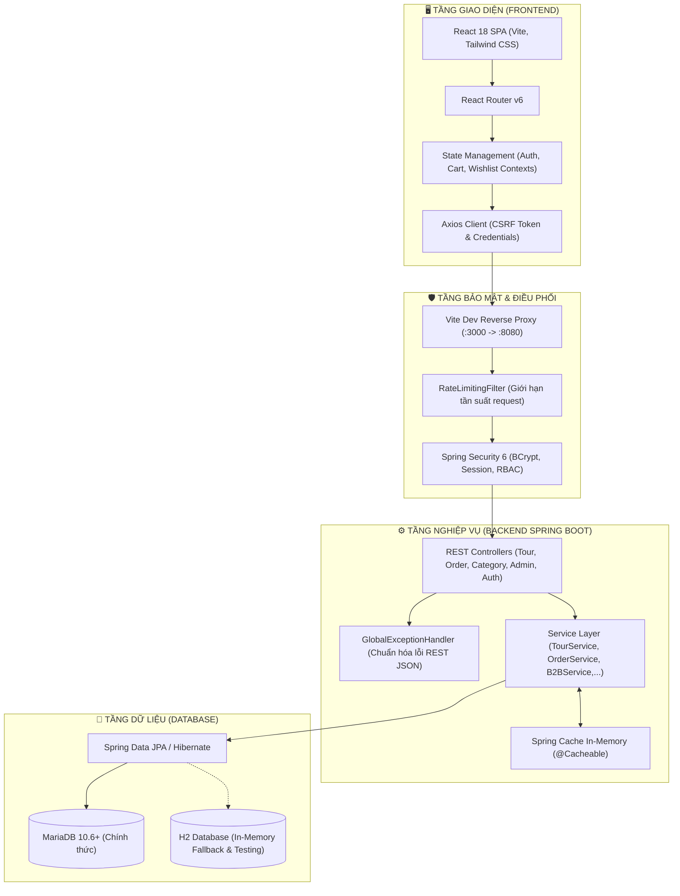
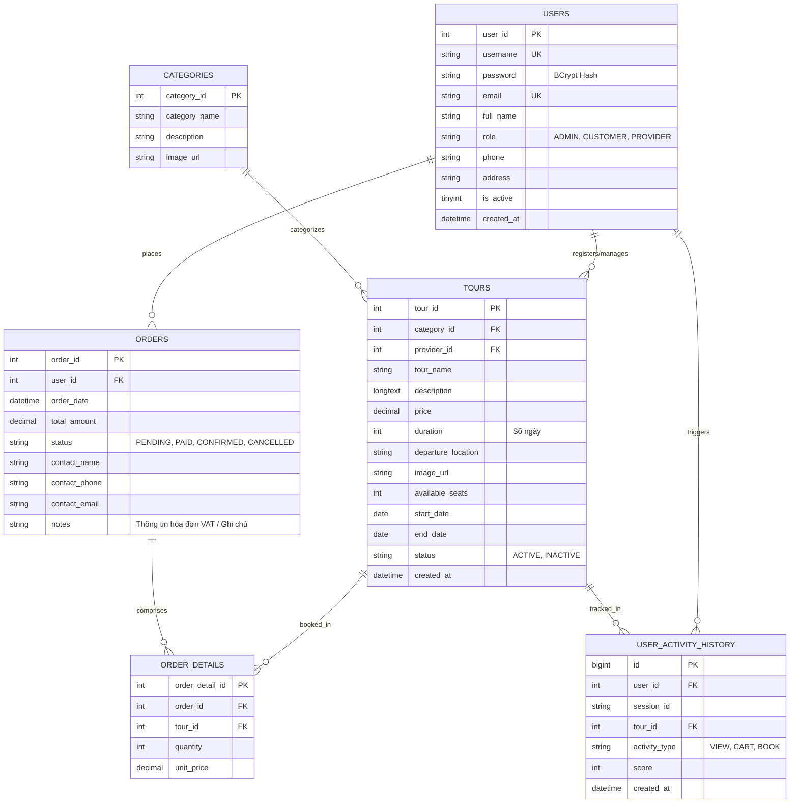

# 🌴 Du Lịch Việt (TourBooking Platform)
### Hệ Thống Giới Thiệu & Đăng Ký Tour Du Lịch Trực Tuyến

<p align="center">
  
</p>

<p align="center">
  
  
  
  
  
  
  
  
</p>

---

## 📌 Thông Tin Đề Tài & Học Phần
* **Học phần**: Lập Trình WWW (Java)
* **Đề tài**: **Đề tài số 49 — Website giới thiệu tour du lịch và cho phép đăng ký tour trực tuyến**
* **Đơn vị đào tạo**: Khoa Công nghệ Thông tin — Trường Đại học Công nghiệp TP. Hồ Chí Minh (IUH)
* **Giảng viên hướng dẫn**: **ThS. Nguyễn Vũ Lâm**
* **Nhóm thực hiện**: **Nhóm 5 (Lớp DHKTPM19ATT)**
* **Tài liệu đặc tả kiến trúc & chức năng**: [`docs/DACTAC_KIENTRUC_VA_CHUNANG.md`](docs/DACTAC_KIENTRUC_VA_CHUNANG.md)
* **Báo cáo tổng kết môn học**: [`docs/Nhom5_Detai49_BaoCaoCuoiKy.docx`](docs/Nhom5_Detai49_BaoCaoCuoiKy.docx)

---

## 📖 Mục Lục
1. [Giới Thiệu Tổng Quan](#-1-giới-thiệu-tổng-quan)
2. [Kiến Trúc Kỹ Thuật & Mô Hình Dữ Liệu](#-2-kiến-trúc-kỹ-thuật--mô-hình-dữ-liệu)
3. [Các Chức Năng Chính](#-3-các-chức-năng-chính)
4. [Hướng Dẫn Cài Đặt & Khởi Chạy](#-4-hướng-dẫn-cài-đặt--khởi-chạy)
5. [Danh Sách Tài Khoản Thử Nghiệm](#-5-danh-sách-tài-khoản-thử-nghiệm)
6. [Danh Mục REST API Cốt Lõi](#-6-danh-mục-rest-api-cốt-lõi)
7. [Kiểm Thử Tự Động & Ràng Buộc An Toàn (Safe Delete)](#-7-kiểm-thử-tự-động--ràng-buộc-an-toàn-safe-delete)
8. [Cấu Trúc Thư Mục Dự Án](#-8-cấu-trúc-thư-mục-dự-án)
9. [Thành Viên Nhóm Thực Hiện & Tỷ Lệ Đóng Góp](#-9-thành-viên-nhóm-thực-hiện--tỷ-lệ-đóng-góp)

---

## 🌟 1. Giới Thiệu Tổng Quan

**Du Lịch Việt (TourBooking)** là hệ thống website thương mại điện tử chuyên ngành lữ hành, hỗ trợ người dùng tra cứu, tìm kiếm và đặt tour trực tuyến. Hệ thống được phát triển theo kiến trúc 3 tầng chuẩn Java Enterprise (Spring Boot 3 + React SPA), tối ưu hóa trải nghiệm trên trình duyệt máy tính cá nhân (PC/Laptop màn hình rộng).

Hệ thống kết nối và phục vụ 4 nhóm đối tượng:
1. **Khách hàng cá nhân (Customer)**: Tìm kiếm tour đa tiêu chí, xem lịch trình theo ngày, lưu tour yêu thích, đặt tour trực tuyến và quản lý lịch sử đơn hàng.
2. **Khách hàng doanh nghiệp (B2B)**: Đặt tour đoàn với thuật toán chiết khấu tự động theo số lượng khách và xuất hóa đơn GTGT (VAT).
3. **Nhà cung cấp tour (Tour Provider)**: Quản lý danh mục tour và theo dõi số chỗ của riêng đơn vị mình (phân lập dữ liệu đối tác).
4. **Quản trị viên (Admin)**: Quản trị danh mục, duyệt đơn hàng, theo dõi thống kê doanh thu và quản lý người dùng với cơ chế bảo vệ an toàn dữ liệu (Safe Delete).

---

## 🏗️ 2. Kiến Trúc Kỹ Thuật & Mô Hình Dữ Liệu

### 2.1. Kiến Trúc 3 Tầng Tổng Quan (3-Tier Architecture)



### 2.2. Sơ Đồ Thực Thể Quan Hệ (ERD)



### 2.3. Ma Trận Phân Quyền Vai Trò (RBAC Matrix)

| Chức Năng Nghiệp Vụ | Khách Vãng Lai | Khách Cá Nhân (`CUSTOMER`) | Khách Doanh Nghiệp (`B2B`) | Đối Tác (`PROVIDER`) | Quản Trị Viên (`ADMIN`) |
| :--- | :---: | :---: | :---: | :---: | :---: |
| Xem danh sách, chi tiết tour & tìm kiếm | ✅ | ✅ | ✅ | ✅ | ✅ |
| Đặt tour trực tuyến & giỏ hàng | ❌ *(Cần đăng nhập)* | ✅ | ✅ | ❌ | ❌ |
| Chiết khấu đoàn B2B (5% - 10%) & Xuất hóa đơn VAT | ❌ | ❌ | ✅ | ❌ | ❌ |
| Xem lịch sử & Hủy đơn hàng | ❌ | ✅ *(Đơn của mình)* | ✅ *(Đơn của mình)* | ❌ | ✅ *(Toàn bộ đơn)* |
| Quản lý tour riêng của nhà cung cấp | ❌ | ❌ | ❌ | ✅ *(Tour của mình)* | ✅ *(Toàn quyền)* |
| Quản trị danh mục & Safe Delete | ❌ | ❌ | ❌ | ❌ | ✅ *(Toàn quyền)* |
| Báo cáo doanh thu & Xuất file CSV UTF-8 | ❌ | ❌ | ❌ | ❌ | ✅ *(Toàn quyền)* |

---

## 🚀 3. Các Chức Năng Chính

1. **Khám Phá & Đặt Tour**:
   - Bộ lọc tìm kiếm đa tiêu chí: Danh mục, khoảng giá, điểm khởi hành, số ngày.
   - Trang chi tiết tour với hành trình theo từng ngày, hình ảnh thắng cảnh và chính sách hoàn hủy.
   - Đặt cọc linh hoạt: Hỗ trợ thanh toán toàn bộ hoặc cọc (30% cho tour nội địa, 50% cho tour quốc tế).
   - Cơ chế hoàn tiền theo thời gian: Hủy trước 15 ngày hoàn 100%, trước 7 ngày hoàn 70%, trước 3 ngày hoàn 50%, dưới 3 ngày không hoàn tiền.
2. **Nghiệp Vụ Doanh Nghiệp (B2B)**:
   - Tự động áp dụng chiết khấu bậc thang cho đoàn: Giảm 5% cho đoàn từ 10–19 khách; giảm 10% cho đoàn từ 20 khách trở lên.
   - Nhập thông tin xuất hóa đơn đỏ (VAT) trực tiếp khi đặt chỗ.
3. **Cơ Chế Safe Delete (Bảo Vệ Toàn Vẹn Dữ Liệu)**:
   - Chặn xóa Danh mục nếu đang có tour trực thuộc.
   - Chặn xóa Tour nếu đã có đơn đặt hàng phát sinh từ khách hàng.
   - Chặn xóa Tài khoản đối tác nếu vẫn còn tour đang mở bán.
4. **Trợ Lý Tư Vấn AI (Tích hợp Google Gemini)**:
   - Hộp chat AI nổi ở góc màn hình, hỗ trợ tư vấn thông tin điểm đến, thời tiết và gợi ý lịch trình phù hợp với nhu cầu của du khách.

---

## ⚡ 4. Hướng Dẫn Cài Đặt & Khởi Chạy

Dự án hỗ trợ 3 phương án chạy linh hoạt tùy theo nhu cầu:

### Cách 1: Chạy Nhanh Trải Nghiệm Giao Diện (Zero-Setup)
> *Phù hợp để xem nhanh giao diện và luồng thao tác. Frontend có sẵn Mock API tự động hoạt động khi chưa bật Backend.*

```powershell
npm install
npm run dev
```
👉 Truy cập: **`http://localhost:3000`**

---

### Cách 2: Chạy Full-Stack Với H2 In-Memory (Không Cần Cài MariaDB)
> *Phù hợp để chấm đồ án hoặc demo nhanh: Spring Boot tự động tạo bảng và nạp dữ liệu mẫu vào RAM, không cần cấu hình database.*

**Bước 1: Chạy Backend Spring Boot (Terminal 1)**
```powershell
cd backend
.\gradlew.bat bootRun --args='--spring.profiles.active=h2'
```
*(Trên macOS/Linux dùng: `./gradlew bootRun --args='--spring.profiles.active=h2'`)*  
Backend sẽ khởi chạy tại: `http://localhost:8080`.

**Bước 2: Chạy Frontend React (Terminal 2)**
```powershell
npm run dev
```
👉 Truy cập: **`http://localhost:3000`**

---

### Cách 3: Chạy Full-Stack Chuẩn Với MariaDB (Chuẩn Nộp Bài)
> *Phù hợp môi trường kiểm thử chính thức với hệ quản trị CSDL quan hệ.*

1. **Khởi tạo Database**:
   - Kết nối MariaDB/MySQL server tại `127.0.0.1:3306`.
   - Chạy tệp [`database/schema.sql`](database/schema.sql) để tạo bảng.
   - Chạy tệp [`database/data.sql`](database/data.sql) để nạp dữ liệu mẫu ban đầu.
2. **Khởi chạy Backend**:
   ```powershell
   cd backend
   # Cung cấp mật khẩu DB nếu có:
   $env:DB_PASSWORD="your_password"
   .\gradlew.bat bootRun
   ```
3. **Khởi chạy Frontend**:
   ```powershell
   npm run dev
   ```
   👉 Truy cập: **`http://localhost:3000`**

---

## 👥 5. Danh Sách Tài Khoản Thử Nghiệm

Tất cả tài khoản thử nghiệm sử dụng mật khẩu chung: **`123456`**

| Tên Đăng Nhập | Mật Khẩu | Vai Trò (Role) | Mô Tả & Kịch Bản Đề Xuất |
| :--- | :--- | :--- | :--- |
| **`admin`** | `123456` | `ADMIN` | Quản trị toàn bộ tour, danh mục, duyệt đơn, xuất báo cáo CSV UTF-8 và thử nghiệm Safe Delete. |
| **`customer`** | `123456` | `CUSTOMER` | Khách hàng cá nhân: đặt tour, quản lý giỏ hàng, hủy đơn theo bậc, chat tư vấn AI. |
| **`fpt_corp`** | `123456` | `CUSTOMER` *(B2B)* | Khách hàng doanh nghiệp: đặt đoàn $\ge 10$ người để nhận chiết khấu 5% - 10% và xuất hóa đơn VAT. |
| **`vietravel`** | `123456` | `PROVIDER` | Nhà cung cấp: chỉ quản lý danh sách tour riêng của Vietravel (Provider Isolation). |
| **`saigontourist`** | `123456` | `PROVIDER` | Nhà cung cấp: chỉ quản lý danh sách tour riêng của SaigonTourist. |

---

## 🔌 6. Danh Mục REST API Cốt Lõi

| Nhóm API | Phương Thức | Đường Dẫn (Endpoint) | Phân Quyền | Chức Năng |
| :--- | :---: | :--- | :---: | :--- |
| **Xác thực** | `POST` | `/api/auth/login` | Public | Đăng nhập hệ thống (Username/Email), lưu phiên bảo mật |
| | `POST` | `/api/auth/register` | Public | Đăng ký tài khoản khách hàng mới |
| **Danh mục** | `GET` | `/api/categories` | Public | Lấy danh sách danh mục tour (có cache) |
| **Tour** | `GET` | `/api/tours` | Public | Lấy danh sách tour du lịch (hỗ trợ phân trang, lọc) |
| | `GET` | `/api/tours/{id}` | Public | Lấy chi tiết tour, lịch trình theo ngày và số chỗ trống |
| | `GET` | `/api/tours/search?keyword=...` | Public | Tìm kiếm tour theo điểm đến hoặc tên tour |
| **Đơn Hàng** | `POST` | `/api/orders` | Customer | Tạo đơn đặt tour, kiểm tra trừ chỗ nguyên tử và chiết khấu B2B |
| | `GET` | `/api/orders/my` | Customer | Xem danh sách đơn hàng đã đặt của người dùng |
| | `POST` | `/api/orders/{id}/cancel` | Customer | Hủy đơn và hoàn lại số chỗ trống vào tour |
| **Quản Trị** | `GET` | `/api/admin/dashboard` | Admin | Lấy chỉ số tổng doanh thu, số đơn hàng và tỷ lệ lấp đầy |
| | `DELETE` | `/api/admin/tours/{id}` | Admin | Xóa tour có kiểm tra ràng buộc đơn hàng (Safe Delete) |
| | `DELETE` | `/api/admin/categories/{id}` | Admin | Xóa danh mục có kiểm tra tour trực thuộc |
| | `GET` | `/api/admin/reports/export` | Admin | Xuất báo cáo tài chính dạng CSV chuẩn UTF-8 BOM |

---

## 🧪 7. Kiểm Thử Tự Động & Ràng Buộc An Toàn (Safe Delete)

Dự án được trang bị bộ kiểm thử tự động toàn diện nhằm đảm bảo tính toàn vẹn nghiệp vụ:

### 1. Kiểm Thử Frontend & Nghiệp Vụ (`npm test`)
Thực thi kiểm thử 5 bộ kịch bản tự động:
```powershell
npm test
```
*Kết quả kiểm thử: **287/287 tests PASS** (100%), bao gồm kiểm tra route, phân quyền, rào chắn vùng miền, giao dịch thanh toán và chính sách hủy vé.*

### 2. Kiểm Thử Backend Unit Test (`JUnit 5`)
```powershell
cd backend
.\gradlew.bat test
```
*Bao phủ các ca kiểm thử dịch vụ: `OrderServiceTest`, `TourServiceTest`, `CategoryServiceTest`, và kiểm tra số học làm tròn B2B.*

### 3. Kịch Bản Kiểm Tra Ràng Buộc Safe Delete Thao Tác Trực Tiếp
1. **Xóa danh mục có tour**: Đăng nhập `admin` > Vào Quản lý danh mục > Bấm xóa Danh mục ID 1 (*Du lịch Biển Đảo*). Hệ thống sẽ chặn lại với thông báo: *"Không thể xóa danh mục vì vẫn còn tour trực thuộc"*.
2. **Xóa tour đã phát sinh đơn**: Vào Quản lý Tour > Bấm xóa Tour ID 1 (*Thiên đường biển đảo Phú Quốc*). Hệ thống từ chối thao tác nhằm bảo vệ tính toàn vẹn dữ liệu đơn hàng cũ.

---

## 📁 8. Cấu Trúc Thư Mục Dự Án

```text
JavaWWW_Nhom5_TourBooking/
├── backend/                               # Mã nguồn Backend Java Spring Boot
│   ├── src/main/java/vn/dulichviet/tourbooking/
│   │   ├── config/                        # Cấu hình Security, DataInitializer, Cache
│   │   ├── controller/                    # REST API Controllers
│   │   ├── dto/                           # Data Transfer Objects
│   │   ├── entity/                        # Các thực thể JPA (User, Tour, Category,...)
│   │   ├── exception/                     # Bộ xử lý lỗi toàn cục GlobalExceptionHandler
│   │   ├── repository/                    # Giao diện Spring Data JPA Repositories
│   │   └── service/                       # Logic nghiệp vụ (TourService, OrderService,...)
│   ├── src/main/resources/
│   │   ├── application.properties         # Cấu hình kết nối MariaDB mặc định
│   │   └── application-h2.properties      # Cấu hình In-Memory H2 fallback
│   ├── build.gradle                       # Cấu hình dependencies và build Gradle
│   └── gradlew.bat                        # Gradle Wrapper thực thi
├── database/                              # Kịch bản cơ sở dữ liệu
│   ├── schema.sql                         # Khởi tạo bảng và ràng buộc khóa ngoại
│   └── data.sql                           # Dữ liệu mẫu hoàn chỉnh (Users, Tours, Orders)
├── docs/                                  # Tài liệu phân tích, đặc tả và báo cáo
│   ├── DACTAC_KIENTRUC_VA_CHUNANG.md      # Đặc tả chi tiết Use Cases, ERD, Sequence, RBAC
│   └── Nhom5_Detai49_BaoCaoCuoiKy.docx    # Báo cáo tổng kết đồ án môn học
├── scripts/                               # Các kịch bản kiểm thử tự động
│   ├── project_integrity_and_health_check.cjs
│   ├── test_all_roles_and_flows.cjs
│   ├── test_geographic_isolation.cjs
│   ├── test_admin_suite_and_extensions.cjs
│   └── comprehensive_test_suite.cjs
├── src/                                   # Mã nguồn Frontend React SPA
│   ├── api/                               # Cấu hình Axios và bộ xử lý API
│   ├── components/                        # UI Components (Header, Footer, TourCard, Chatbot,...)
│   ├── context/                           # React Context (AuthContext, CartContext,...)
│   ├── pages/                             # Các trang giao diện người dùng và quản trị
│   ├── utils/                             # Tiện ích định dạng tiền tệ, ngày tháng
│   ├── App.jsx                            # Cấu hình Routing chính
│   └── index.jsx                          # Điểm khởi chạy React DOM
├── package.json                           # Khai báo thư viện và script Frontend
├── vite.config.ts                         # Cấu hình Vite Dev Server & Reverse Proxy
└── README.md                              # Hướng dẫn dự án
```

---

## 👨‍💻 9. Thành Viên Nhóm Thực Hiện & Tỷ Lệ Đóng Góp

| STT | Họ và Tên | Mã Số Sinh Viên | Vai Trò | Đóng Góp | Nội Dung Công Việc Phụ Trách |
| :-: | :--- | :-: | :---: | :-: | :--- |
| 1 | **Vũ Trần Đức Nghĩa** | 23637711 | **Nhóm trưởng / Backend Lead** | **38%** *(Nhiều nhất)* | • Thiết kế kiến trúc tổng thể 3 tầng của hệ thống.<br/>• Xây dựng tầng nghiệp vụ Backend Spring Boot cốt lõi: xử lý đơn hàng (`OrderService`), kiểm soát giao dịch `@Transactional`, logic trừ số chỗ khả dụng, quy tắc cọc và chính sách hoàn tiền theo thời gian.<br/>• Thiết lập cơ chế kiểm soát ràng buộc an toàn dữ liệu (`Safe Delete Invariant`) và thuật toán chiết khấu bậc thang cho khách đoàn B2B.<br/>• Tích hợp trợ lý tư vấn du lịch AI kết nối Google Gemini API.<br/>• Xây dựng bộ kiểm thử tự động toàn diện và chủ trì biên soạn tài liệu báo cáo đề tài. |
| 2 | **Nguyễn Đình Phi** | 23633271 | **Thành viên / Frontend Lead** | **32.25%** *(Hơn Sơn 5%)* | • Xây dựng giao diện người dùng React 18 SPA: Trang chủ, Trang danh sách Tour với bộ lọc đa tiêu chí, Trang chi tiết tour kèm lịch trình theo ngày và form đặt chỗ.<br/>• Quản lý trạng thái ứng dụng: Giỏ hàng (`CartContext`), Danh sách yêu thích (`WishlistContext`), Lịch sử đơn hàng cá nhân (`MyOrdersPage`).<br/>• Thiết kế giao diện hộp thoại tư vấn AI Chatbot và kết nối API Backend qua Axios client. |
| 3 | **Lê Viết Cao Sơn** | 23637311 | **Thành viên / Database & Security** | **27.25%** | • Thiết kế và chuẩn hóa cơ sở dữ liệu quan hệ MariaDB (14 bảng, ràng buộc khóa chính/khóa ngoại, chỉ mục tìm kiếm) cùng bộ dữ liệu mẫu tiếng Việt (`schema.sql`, `data.sql`).<br/>• Cấu hình bảo mật hệ thống Spring Security 6: Phân quyền theo vai trò (RBAC), phòng chống tấn công qua bộ lọc giới hạn tần suất (`RateLimitingFilter`).<br/>• Cấu hình cấu hình dự phòng H2 Database phục vụ kiểm thử và chạy thử nghiệm không cần cài đặt CSDL. |
| 4 | **Trần Hoàng Nam** | 23639071 | **Thành viên / Admin Support & Docs** | **2.5%** *(Ít nhất)* | • Hỗ trợ xây dựng giao diện các form nhập liệu cơ bản trong phân hệ Admin (CRUD Danh mục tour, Form thêm/sửa thông tin tour cơ bản).<br/>• Thu thập dữ liệu hình ảnh các điểm đến du lịch, kiểm thử thủ công chức năng đặt vé trên giao diện và hỗ trợ tổng hợp tài liệu báo cáo Word. |

---

## 📄 Giấy Phép
Dự án được phát hành theo giấy phép [MIT License](LICENSE). Mã nguồn phục vụ mục đích học tập và nghiên cứu trong khuôn khổ môn học Lập trình WWW (Java) tại Trường Đại học Công nghiệp TP. Hồ Chí Minh (IUH).
