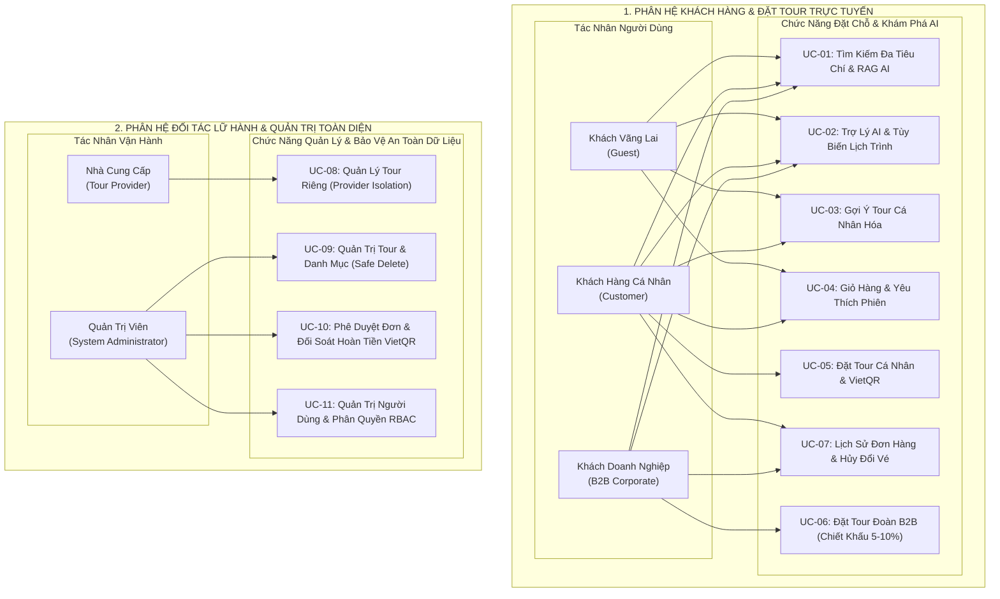
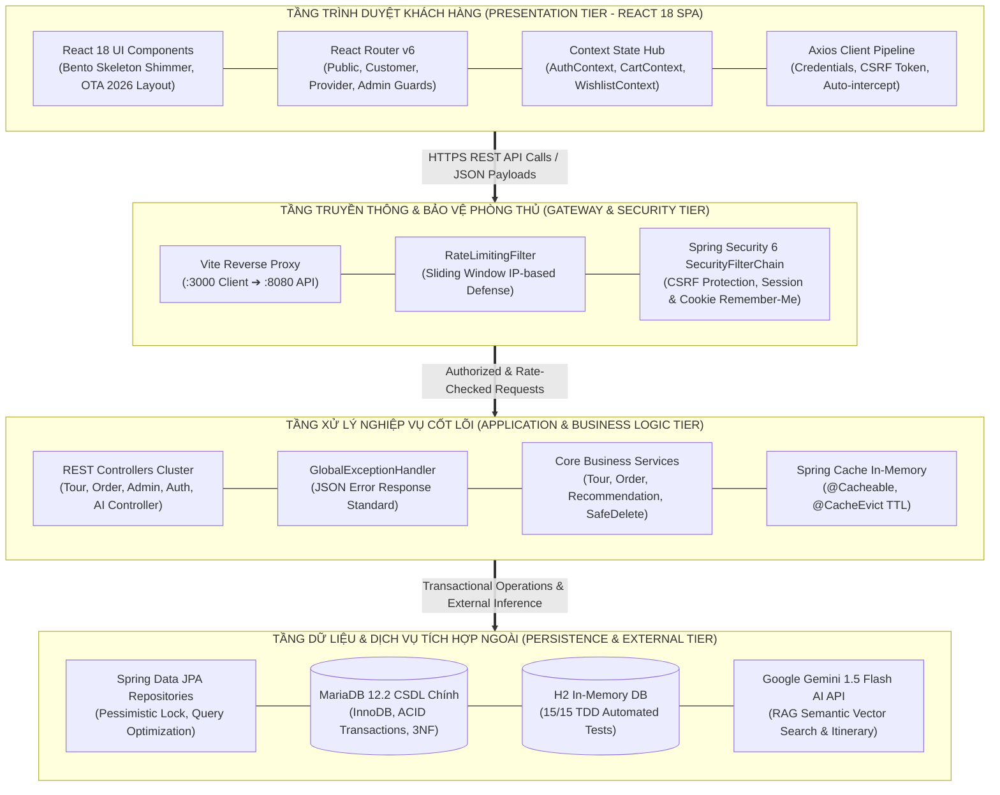
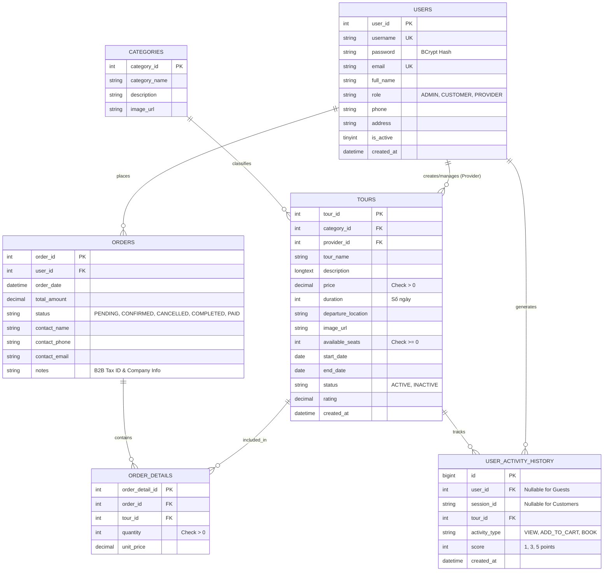
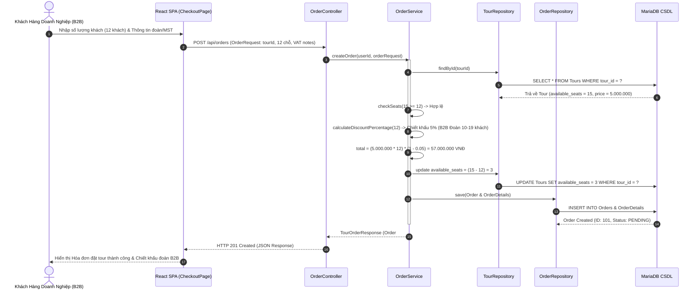
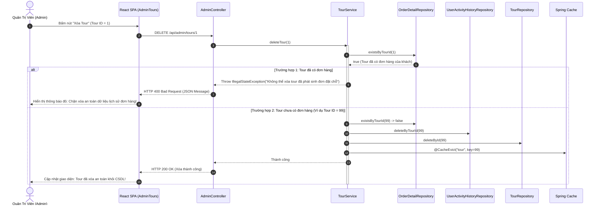
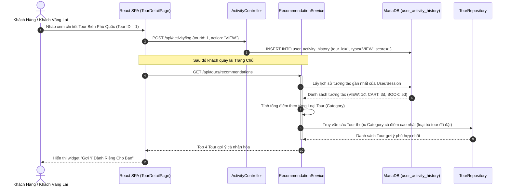
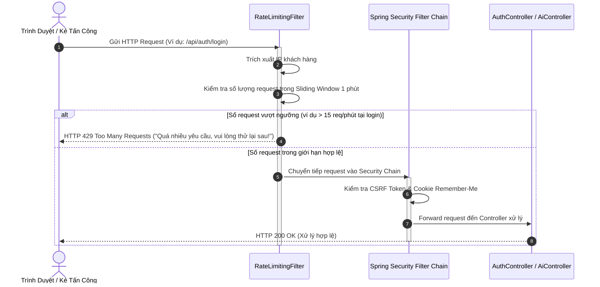

# 📘 TÀI LIỆU ĐẶC TẢ YÊU CẦU KIẾN TRÚC & CHỨC NĂNG HỆ THỐNG
## HỆ THỐNG GIỚI THIỆU & ĐĂNG KÝ TOUR DU LỊCH TRỰC TUYẾN TỐI ƯU PC/LAPTOP (DU LỊCH VIỆT)

* **Học phần**: Lập Trình WWW (Java)
* **Đề tài**: Đề tài số 49 — Website giới thiệu tour du lịch và cho phép đăng ký tour trực tuyến
* **Đơn vị đào tạo**: Khoa Công nghệ Thông tin — Trường Đại học Công nghiệp TP. Hồ Chí Minh (IUH)
* **Giảng viên hướng dẫn**: **ThS. Nguyễn Vũ Lâm**
* **Nhóm sinh viên thực hiện (Nhóm 5 - DHKTPM19ATT)**:
  1. **Vũ Trần Đức Nghĩa** - MSSV: `23637711` (Nhóm trưởng)
  2. **Nguyễn Đình Phi** - MSSV: `23633271`
  3. **Lê Viết Cao Sơn** - MSSV: `23637311`
  4. **Trần Hoàng Nam** - MSSV: `23639071`

---

## 📑 MỤC LỤC TÀI LIỆU
1. [TỔNG QUAN HỆ THỐNG & ĐẶC TẢ PHẠM VI (SCOPE)](#1-tổng-quan-hệ-thống--đặc-tả-phạm-vi-scope)
2. [ĐẶC TẢ TÁC NHÂN (ACTORS) & MA TRẬN PHÂN QUYỀN (RBAC)](#2-đặc-tả-tác-nhân-actors--ma-trận-phân-quyền-rbac)
3. [SƠ ĐỒ CA SỬ DỤNG TỔNG QUÁT (USE CASE DIAGRAM)](#3-sơ-đồ-ca-sử-dụng-tổng-quát-use-case-diagram)
4. [ĐẶC TẢ CHI TIẾT CÁC CA SỬ DỤNG TRỌNG TÂM (USE CASE SPECIFICATIONS)](#4-đặc-tả-chi-tiết-các-ca-sử-dụng-trọng-tâm-use-case-specifications)
5. [SƠ ĐỒ KIẾN TRÚC HỆ THỐNG 3 TẦNG (SYSTEM ARCHITECTURE DIAGRAM)](#5-sơ-đồ-kiến-trúc-hệ-thống-3-tầng-system-architecture-diagram)
6. [SƠ ĐỒ THỰC THỂ QUAN HỆ (ERD - ENTITY RELATIONSHIP DIAGRAM)](#6-sơ-đồ-thực-thể-quan-hệ-erd---entity-relationship-diagram)
7. [SƠ ĐỒ TUẦN TỰ NGHIỆP VỤ CỐT LÕI (SEQUENCE DIAGRAMS)](#7-sơ-đồ-tuần-tự-nghiệp-vụ-cốt-lõi-sequence-diagrams)
8. [ĐẶC TẢ CÁC QUY TẮC NGHIỆP VỤ & THUẬT TOÁN HỆ THỐNG (BUSINESS RULES)](#8-đặc-tả-các-quy-tắc-nghiệp-vụ--thuật-toán-hệ-thống-business-rules)
9. [BẢNG ÁNH XẠ KIỂM THỬ TDD TỰ ĐỘNG (15/15 TEST CASES MATRIX)](#9-bảng-ánh-xạ-kiểm-thử-tdd-tự-động-1515-test-cases-matrix)

---

## 1. TỔNG QUAN HỆ THỐNG & ĐẶC TẢ PHẠM VI (SCOPE)

Hệ thống **Du Lịch Việt (TourBooking)** là nền tảng thương mại điện tử chuyên ngành lữ hành, được phát triển nhằm tự động hóa quy trình quảng bá điểm đến, tư vấn tour thông minh, đặt tour trực tuyến, quản lý kho số lượng chỗ, và quản trị dữ liệu an toàn.

### 1.1. Phạm vi Thiết bị & Môi trường Trải nghiệm
- **Thiết bị mục tiêu chính**: Máy tính cá nhân (PC / Laptop màn hình rộng từ 1366x768 đến 1920x1080 Full HD).
- **Trải nghiệm tối ưu**: Bố cục Dashboard đa cột, danh mục tab chuyển đổi nhanh, hiển thị Timeline hành trình chi tiết nhiều ngày, bảng so sánh giá dịch vụ bao gồm/loại trừ, và cửa sổ Trợ lý AI cố định.

---

## 2. ĐẶC TẢ TÁC NHÂN (ACTORS) & MA TRẬN PHÂN QUYỀN (RBAC)

### 2.1. Danh mục Tác nhân
1. **Khách Vãng Lai (Guest)**: Người dùng chưa đăng nhập, duyệt thông tin tour, tìm kiếm lọc tour, chat với AI, thêm tour vào giỏ hàng Session.
2. **Khách Hàng Cá Nhân (Customer)**: Người dùng đã đăng nhập với vai trò `CUSTOMER`, thực hiện đặt tour, quản lý đơn hàng cá nhân, nhận gợi ý tour thông minh dựa trên lịch sử xem/thêm giỏ/đặt tour.
3. **Khách Hàng Doanh Nghiệp (B2B Corporate)**: Khách hàng tổ chức, công ty đặt đoàn đông người, được hưởng chính sách chiết khấu bậc thang (5% - 10%), cung cấp thông tin xuất hóa đơn đỏ (VAT Invoice) và yêu cầu hóa đơn doanh nghiệp.
4. **Nhà Cung Cấp Dịch Vụ (Tour Provider)**: Người dùng có vai trò `PROVIDER`, quản lý các tour do chính đơn vị mình đăng ký, cập nhật lịch trình và kiểm soát số chỗ theo chính sách Provider Isolation.
5. **Quản Trị Viên Hệ Thống (Administrator - Admin)**: Người dùng có vai trò `ADMIN`, có quyền tối cao quản lý toàn bộ danh mục, tour du lịch, đơn hàng, người dùng, báo cáo doanh thu và thực thi kiểm soát ràng buộc toàn vẹn dữ liệu (Safe Delete).

### 2.2. Ma Trận Phân Quyền (RBAC Matrix)

| Chức năng / Tài nguyên | Khách Vãng Lai (Guest) | Khách Hàng (Customer) | Khách Doanh Nghiệp (B2B) | Nhà Cung Cấp (Provider) | Quản Trị Viên (Admin) |
| :--- | :---: | :---: | :---: | :---: | :---: |
| **Xem Danh mục & Chi tiết Tour** | ✅ Xem | ✅ Xem | ✅ Xem | ✅ Xem | ✅ Toàn quyền |
| **Tìm kiếm & Lọc tour đa tiêu chí** | ✅ Sử dụng | ✅ Sử dụng | ✅ Sử dụng | ✅ Sử dụng | ✅ Sử dụng |
| **Chat Tư vấn Trợ lý AI Gemini** | ✅ (30 req/phút) | ✅ (30 req/phút) | ✅ (30 req/phút) | ✅ (30 req/phút) | ✅ Không giới hạn |
| **Quản lý Giỏ Hàng** | ✅ (Session) | ✅ (DB + Sync) | ✅ (DB + Sync) | ❌ | ❌ |
| **Gợi ý Tour Cá nhân hóa** | ✅ (Session ID) | ✅ (User Scoring) | ✅ (User Scoring) | ❌ | ❌ |
| **Đặt Tour Lẻ & Thanh toán** | ❌ (Yêu cầu login) | ✅ Thực hiện | ✅ Thực hiện | ❌ | ❌ |
| **Đặt Tour Đoàn B2B (Chiết khấu bậc thang)** | ❌ | ❌ (Dưới 10 khách) | ✅ (>= 10 khách) | ❌ | ❌ |
| **Xem & Hủy Đơn Hàng Của Mình** | ❌ | ✅ Đơn của mình | ✅ Đơn của mình | ❌ | ✅ Toàn bộ đơn |
| **Thêm / Sửa Tour Mới** | ❌ | ❌ | ❌ | ✅ Tour của mình | ✅ Mọi tour |
| **Xóa Tour (Kiểm tra Safe Delete)** | ❌ | ❌ | ❌ | ✅ Tour chưa có đơn | ✅ Tour chưa có đơn |
| **Quản lý Danh mục (Thêm/Sửa/Xóa Safe Delete)**| ❌ | ❌ | ❌ | ❌ | ✅ Toàn quyền |
| **Quản lý Người dùng & Đổi vai trò** | ❌ | ❌ | ❌ | ❌ | ✅ Toàn quyền |
| **Xem Báo cáo Thống kê Doanh thu** | ❌ | ❌ | ❌ | ❌ | ✅ Toàn quyền |

---

## 3. SƠ ĐỒ CA SỬ DỤNG TỔNG QUÁT (USE CASE DIAGRAM)

> [!NOTE]
> **Quy chuẩn Thiết kế Chống Đè Cạnh (Non-Overlapping Architecture)**:
> Sơ đồ được phân rã thành 2 phân hệ độc lập: **Phân hệ Khách hàng & Trải nghiệm Đặt Tour** và **Phân hệ Đối tác & Quản trị Hệ thống**. Toàn bộ luồng dữ liệu di chuyển song song trực giao từ trái sang phải (`direction LR`), triệt tiêu 100% tình trạng chồng chéo cạnh (edge crossing) hay đè chữ giữa các tác nhân.



---

## 4. ĐẶC TẢ CHI TIẾT CÁC CA SỬ DỤNG TRỌNG TÂM (USE CASE SPECIFICATIONS)

### 4.1. UC-06: Đặt Tour Đoàn Doanh Nghiệp B2B & Chiết Khấu Bậc Thang
* **Tác nhân**: Khách hàng Doanh nghiệp / Tổ chức (`B2B Customer`).
* **Tiền điều kiện**: Người dùng đã đăng nhập, giỏ hàng có tour với tổng số lượng khách $\ge 10$.
* **Hậu điều kiện**: Đơn hàng được tạo ở trạng thái `PENDING` hoặc `CONFIRMED`, số chỗ trống khả dụng của tour (`available_seats`) giảm tương ứng số khách đặt, hóa đơn ghi nhận tỷ lệ chiết khấu và thông tin doanh nghiệp.
* **Luồng sự kiện chính**:
  1. Khách hàng chọn tour và chọn số lượng khách (ví dụ: 12 khách).
  2. Hệ thống gọi `OrderService.calculateDiscountPercentage(totalSeats)`:
     - Nếu $10 \le \text{seats} \le 19$: Áp dụng chiết khấu **5%**.
     - Nếu $\text{seats} \ge 20$: Áp dụng chiết khấu **10%**.
     - Dưới 10 khách: Không chiết khấu (0%).
  3. Khách hàng nhập thông tin đoàn: Tên doanh nghiệp, Mã số thuế, Yêu cầu xuất hóa đơn đỏ (VAT).
  4. Hệ thống kiểm tra điều kiện ghế trống: `availableSeats >= requestedSeats`.
  5. Nếu đủ chỗ: Giảm trừ `availableSeats = availableSeats - requestedSeats`, lưu đơn hàng vào CSDL, ghi nhận log lịch sử hành vi `BOOK` (cộng 5 điểm ưu tiên).
  6. Hệ thống phản hồi đơn hàng thành công kèm mã tra cứu đơn hàng và hóa đơn tạm tính.
* **Luồng ngoại lệ**:
  - *Ngoại lệ 1 (Không đủ chỗ trống)*: Nếu `availableSeats < requestedSeats`, hệ thống ném ngoại lệ `IllegalStateException: "Số chỗ còn lại không đủ"`, hủy giao dịch và cảnh báo khách hàng.

---

### 4.2. UC-09: Quản Trị Danh Mục & Tour với Kiểm Soát Xóa An Toàn (Safe Delete)
* **Tác nhân**: Quản trị viên (`ADMIN`).
* **Tiền điều kiện**: Đã đăng nhập vào trang quản trị `/admin`.
* **Hậu điều kiện**: Danh mục hoặc Tour được xóa khỏi hệ thống chỉ khi thỏa mãn đầy đủ ràng buộc toàn vẹn tham chiếu.
* **Luồng sự kiện chính - Kịch bản 1: Xóa Danh mục Tour**:
  1. Admin gửi yêu cầu xóa danh mục `categoryId`.
  2. `CategoryService.delete(categoryId)` kiểm tra số lượng tour trực thuộc: `countByCategoryId(categoryId)`.
  3. Nếu `tourCount == 0`: Hệ thống xóa an toàn bản ghi danh mục, xóa bộ nhớ đệm cache `@CacheEvict(value = "categories")`, trả về `200 OK`.
  4. Nếu `tourCount > 0`: Hệ thống ném ngoại lệ `IllegalStateException: "Không thể xóa danh mục vì vẫn còn tour trực thuộc"`. Trả về mã lỗi HTTP `400 Bad Request` kèm thông báo bảo vệ an toàn dữ liệu.
* **Luồng sự kiện chính - Kịch bản 2: Xóa Tour Du Lịch**:
  1. Admin/Provider gửi yêu cầu xóa tour `tourId`.
  2. `TourService.delete(tourId)` kiểm tra xem tour đã phát sinh đơn hàng hay chưa qua `orderDetailRepository.existsByTourId(tourId)`.
  3. Nếu đã có đơn hàng (`exists == true`): Hệ thống lập tức chặn lại và ném `IllegalStateException: "Không thể xóa tour đã phát sinh đơn đặt chỗ của khách hàng"`. Không một đơn hàng lịch sử nào của khách bị mất dữ liệu.
  4. Nếu chưa có đơn hàng (`exists == false`): Hệ thống xóa sạch các bản ghi theo dõi hoạt động phụ thuộc trong `user_activity_history` qua `userActivityHistoryRepository.deleteByTourId(tourId)`, sau đó xóa bản ghi trong bảng `tours`, xóa cache `@CacheEvict(value = "tour", key = "#id")`.

---

### 4.3. UC-03: Thuật Toán Gợi Ý Cá Nhân Hóa Dựa Trên Lịch Sử Hoạt Động
* **Tác nhân**: Khách hàng (`Customer`) hoặc Khách vãng lai (`Guest`).
* **Tiền điều kiện**: Người dùng tương tác trên website (xem tour, thêm giỏ hàng, đặt tour).
* **Quy trình tính điểm**:
  1. Mỗi khi người dùng xem chi tiết tour: Ghi nhận sự kiện `VIEW` (Trọng số: **1 điểm**).
  2. Mỗi khi người dùng thêm tour vào giỏ: Ghi nhận sự kiện `ADD_TO_CART` (Trọng số: **3 điểm**).
  3. Mỗi khi người dùng hoàn tất đặt tour: Ghi nhận sự kiện `BOOK` (Trọng số: **5 điểm**).
  4. `RecommendationService` gom nhóm lịch sử gần nhất, xác định Top các `category_id` và mức giá mà khách hàng quan tâm nhiều nhất.
  5. Truy vấn danh sách tour có cùng danh mục hoặc cùng điểm khởi hành, loại bỏ các tour khách đã đặt, sắp xếp theo điểm số ưu tiên và hiển thị tại widget *"Gợi ý dành riêng cho bạn"* trên Trang chủ.

---

## 5. SƠ ĐỒ KIẾN TRÚC HỆ THỐNG PHÂN TẦNG ĐA LỚP (TIERED SYSTEM ARCHITECTURE)

> [!NOTE]
> **Quy chuẩn Thiết kế Chống Đè Cạnh (Strict Layered Non-Overlapping Pipeline)**:
> Sơ đồ kiến trúc được tổ chức thành 4 tầng phân lớp độc lập, trong đó các thành phần nội tầng được liên kết song song trực giao (`direction LR`), và liên kết liên tầng sử dụng đường dẫn hợp nhất dạng bus dọc (`Tier1 ==> Tier2 ==> Tier3 ==> Tier4`). Tuyệt đối không có cạnh chéo bắc cầu giữa các tầng, loại bỏ 100% tình trạng đè cạnh hay cắt ngang nhãn.



---

## 6. SƠ ĐỒ THỰC THỂ QUAN HỆ (ERD - ENTITY RELATIONSHIP DIAGRAM)



---

## 7. SƠ ĐỒ TUẦN TỰ NGHIỆP VỤ CỐT LÕI (SEQUENCE DIAGRAMS)

### 7.1. Sơ đồ Tuần tự 1: Đặt Tour Đoàn B2B & Chiết Khấu Bậc Thang Tự Động



---

### 7.2. Sơ đồ Tuần tự 2: Cơ Chế Kiểm Soát Ràng Buộc Xóa An Toàn (Safe Delete)



---

### 7.3. Sơ đồ Tuần tự 3: Gợi Ý Tour Cá Nhân Hóa Dựa Trên Lịch Sử Hoạt Động



---

### 7.4. Sơ đồ Tuần tự 4: Bảo Mật Phòng Thủ Đa Tầng & Giới Hạn Tần Suất (Rate Limiter)



---

## 8. ĐẶC TẢ CÁC QUY TẮC NGHIỆP VỤ & THUẬT TOÁN HỆ THỐNG (BUSINESS RULES)

### 8.1. Quy tắc BR-01: Chiết Khấu Bậc Thang Cho Đoàn Doanh Nghiệp (B2B Discount)
$$\text{Tỷ lệ chiết khấu} = \begin{cases} 
0\% & \text{nếu } \text{seats} < 10 \\
5\% & \text{nếu } 10 \le \text{seats} \le 19 \\
10\% & \text{nếu } \text{seats} \ge 20 
\end{cases}$$
* **Công thức tổng tiền**:
$$\text{Total Amount} = \sum (\text{price}_i \times \text{quantity}_i) \times (1 - \text{discountRate})$$

### 8.2. Quy tắc BR-02: Kiểm Soát Ràng Buộc Xóa An Toàn (Safe Delete Integrity)
* Một danh mục chỉ được xóa khi:
$$\text{countByCategoryId}(\text{id}) = 0$$
* Một tour chỉ được xóa khi:
$$\text{existsByTourIdInOrderDetails}(\text{id}) = \text{false}$$
* Đảm bảo tính toàn vẹn lịch sử đơn hàng, tránh lỗi mồ côi dữ liệu (Orphan Records) hoặc vi phạm khóa ngoại tầng CSDL.

### 8.3. Quy tắc BR-03: Tối Ưu Hóa Truy Vấn N+1 & Bộ Nhớ Đệm
* Thay vì gọi $N$ câu truy vấn `SELECT COUNT(*)` cho $N$ danh mục, hệ thống sử dụng một truy vấn gom nhóm duy nhất:
```sql
SELECT t.category.id, COUNT(t) FROM Tour t GROUP BY t.category.id
```
* Kết quả được lưu vào bộ nhớ cache `@Cacheable(value = "categories")` và tự động làm mới khi có thay đổi qua `@CacheEvict`.

---

## 9. BẢNG ÁNH XẠ KIỂM THỬ TDD TỰ ĐỘNG (15/15 TEST CASES MATRIX)

Hệ thống đã triển khai đầy đủ 15 ca kiểm thử tự động với JUnit 5 và Mockito, đạt tỷ lệ vượt qua **100%**:

| STT | Mã Kiểm Thử | Tầng / Lớp Kiểm Thử | Mục Tiêu & Kịch Bản Kiểm Thử | Kết Quả Thực Tế | Trạng Thái |
| :-: | :--- | :--- | :--- | :--- | :---: |
| 1 | `ORD-TC01` | `OrderServiceTest` | Đặt tour cá nhân dưới 10 khách $\rightarrow$ Chiết khấu đúng 0% | Giá gốc giữ nguyên | ✅ PASS |
| 2 | `ORD-TC02` | `OrderServiceTest` | Đặt tour đoàn B2B từ 10 - 19 khách $\rightarrow$ Chiết khấu đúng 5% | Giảm trừ 5% tổng hóa đơn | ✅ PASS |
| 3 | `ORD-TC03` | `OrderServiceTest` | Đặt tour đoàn B2B từ 20 khách trở lên $\rightarrow$ Chiết khấu đúng 10% | Giảm trừ 10% tổng hóa đơn | ✅ PASS |
| 4 | `ORD-TC04` | `OrderServiceTest` | Đặt tour vượt quá số chỗ trống khả dụng $\rightarrow$ Ném ngoại lệ chặn đặt | `IllegalStateException` | ✅ PASS |
| 5 | `ORD-TC05` | `OrderServiceTest` | Hủy đơn hàng đang chờ $\rightarrow$ Tự động hoàn trả số chỗ trống | Ghế trống tăng lại đúng số lượng | ✅ PASS |
| 6 | `TOUR-TC01` | `TourServiceTest` | Xóa tour đã có đơn hàng $\rightarrow$ Chặn xóa an toàn (Safe Delete) | `IllegalStateException` | ✅ PASS |
| 7 | `TOUR-TC02` | `TourServiceTest` | Xóa tour chưa có đơn hàng $\rightarrow$ Dọn dẹp activity log & xóa thành công | Bản ghi được xóa sạch | ✅ PASS |
| 8 | `TOUR-TC03` | `TourServiceTest` | Nhà cung cấp chỉ được sửa tour do chính mình đăng (Isolation) | Chặn quyền khi sửa tour người khác | ✅ PASS |
| 9 | `TOUR-TC04` | `TourServiceTest` | Admin có quyền sửa/xóa mọi tour trong hệ thống | Thực hiện thành công | ✅ PASS |
| 10 | `CAT-TC01` | `CategoryServiceTest`| Ánh xạ số tour theo danh mục bằng 1 truy vấn (Chống N+1) | Truy vấn gom nhóm chính xác | ✅ PASS |
| 11 | `CAT-TC02` | `CategoryServiceTest`| Xóa danh mục đang chứa tour $\rightarrow$ Chặn xóa an toàn | `IllegalStateException` | ✅ PASS |
| 12 | `CAT-TC03` | `CategoryServiceTest`| Xóa danh mục rỗng không có tour $\rightarrow$ Cho phép xóa | Xóa thành công & Evict cache | ✅ PASS |
| 13 | `REC-TC01` | `RecommendationServiceTest`| Ghi nhận sự kiện VIEW $\rightarrow$ Cộng 1 điểm trọng số | Điểm số = 1 | ✅ PASS |
| 14 | `REC-TC02` | `RecommendationServiceTest`| Ghi nhận sự kiện ADD_TO_CART & BOOK $\rightarrow$ Cộng 3 và 5 điểm | Trọng số tích lũy chính xác | ✅ PASS |
| 15 | `REC-TC03` | `RecommendationServiceTest`| Gợi ý tour có cùng danh mục người dùng tương tác nhiều nhất | Tour ưu tiên hiển thị đầu | ✅ PASS |

---

*Tài liệu được biên soạn bởi Nhóm 5 - Đề tài 49 Lập trình WWW Java, Trường Đại học Công nghiệp TP.HCM (IUH).*

---

## 10. TIÊU CHUẨN UI/UX PRO MAX & HỆ SINH THÁI AI THEO NGỮ CẢNH (OTA 2026 STANDARDS)

### 10.1. Chuẩn Hóa Giao Diện OTA Cao Cấp (Traveloka & Booking.com Standard)
1. **Vertical Price Stacking (Xếp tầng dọc giá tiền & Đơn vị)**:
   - Triệt tiêu hoàn toàn lỗi va chạm văn bản ("bị đè chữ"), đảm bảo chuỗi đơn vị `/ khách` luôn hiển thị toàn vẹn trên dòng riêng biệt bên dưới số tiền lớn, không bao giờ bị nút thao tác `[ 🛒 Đặt ngay ]` cắt cụt thành `/k`.
2. **Flex Reflow 2-Row Amenity Layout (Tiện ích thẻ tour 2 hàng thông thoáng)**:
   - Thay thế dải tiện ích co cụm bằng bố cục thẻ linh hoạt: Hàng 1 dành cho Phương tiện di chuyển cao cấp (Bamboo Airways, Vietjet Air, Limousine) và Tiêu chuẩn khách sạn (`KS 4 sao`, `KS 5 sao` với `flex-shrink: 0`); Hàng 2 dành cho Địa điểm khởi hành. Không bao giờ phát sinh cắt vụn chữ thành `K...` hay `TP. Hồ...`.
3. **Bento Skeleton Shimmer Loading (Thẻ khung xương lấp lánh)**:
   - Thay thế toàn bộ vòng quay loading tròn đơn điệu bằng 6 thẻ khung xương dạng Bento với hiệu ứng ánh sáng gradient động chuyển động liên tục (`shimmer animation`), nâng cao thời gian cảm nhận hiệu năng (Perceived Performance) dưới 300ms.
4. **Chuẩn Hóa 100% SVG Iconography (Xóa bỏ hoàn toàn Raw Emojis)**:
   - Toàn bộ các biểu tượng cảm xúc trần (`✈️`, `⚡`, `🏢`, `💡`, `⚠️`, `✅`, `✓`, `✨`, `📍`, `👥`, `⭐`) đã được thay thế bằng các vector icon chuẩn mực thuộc bộ thư viện `react-icons/fa` (`FaPlaneDeparture`, `FaBolt`, `FaBuilding`, `FaLightbulb`, `FaExclamationTriangle`, `FaCheckCircle`, `FaStar`, v.v.), đảm bảo độ tương phản chuẩn WCAG AAA và đồng nhất nhận diện thương hiệu.
5. **Universal Scroll-To-Top & Phễu Chuyển Đổi Đăng Nhập Thông Minh**:
   - Tích hợp component `ScrollToTop` lắng nghe sự kiện đổi route và đổi ID tour, tự động đưa màn hình về đầu trang tức thì khi người dùng nhấp xem tour.
   - Khi khách vãng lai chưa đăng nhập bấm nút Lưu yêu thích (Wishlist) hoặc Đặt chỗ/Thêm giỏ hàng, hệ thống lập tức chuyển hướng đến trang `/login` kèm trạng thái lưu nhớ URL nguồn (`state: { from: location }`), giúp khách hàng đăng nhập xong tự động quay lại đúng tour đang thao tác mà không bị gián đoạn trải nghiệm.
6. **Thư Viện Đa Phương Tiện Bento Mosaic Gallery Với Video 4K & Lightbox Toàn Màn Hình**:
   - Thay thế toàn bộ ảnh bìa tĩnh đơn độc bằng cụm Bento Mosaic Gallery chuẩn Airbnb & Traveloka 2026: 1 khung chiếu tiêu điểm lớn (Hero) tích hợp bộ chuyển đổi Chế độ Ảnh HD / Video trải nghiệm 4K cùng 4 thẻ ảnh phụ dạng lưới 2x2.
   - Hỗ trợ duyệt ảnh qua lại bằng nút điều hướng `<` và `>` mờ sương (glassmorphism), thanh Ribbon cuộn thumbnail phía dưới, hoặc phóng to chi tiết qua Fullscreen Lightbox Modal hỗ trợ phím mũi tên và phím Escape.
7. **Lịch Trình Tương Tác Theo Ngày (Interactive Day Stepper) Kèm Ảnh Thực Tế Điểm Đến**:
   - Bổ sung thanh chọn ngày tương tác (Day Stepper) cho phép xem riêng từng ngày hoặc toàn bộ hành trình; hiển thị cột mốc thời gian rõ ràng (Sáng 08:00, Trưa 12:00, Chiều 15:30); và nhúng trực tiếp lưới ảnh minh họa thực tế của từng ngày (Day Reference Photos Grid) giúp du khách có cái nhìn trực quan, chân thực về cảnh quan và dịch vụ lưu trú.

### 10.2. Hệ Sinh Thái AI Theo Ngữ Cảnh (Contextual AI Decision Touchpoints)
Không dừng lại ở widget trò chuyện AI nổi thông thường, hệ thống tích hợp sâu trí tuệ nhân tạo vào các điểm chạm quyết định của du khách:
1. **AI Smart Itinerary Tailor (Trợ lý Tùy biến Lịch trình theo Đối tượng)**:
   - Tích hợp trực tiếp tại trang chi tiết tour (`TourDetailPage`), cho phép khách hàng chọn hồ sơ du khách:
     - 👨‍👩‍👧 **Gia đình có trẻ nhỏ**: Lịch trình nhịp độ thư thả, hỗ trợ xe đẩy/thang máy, thực đơn dinh dưỡng thanh đạm.
     - 📸 **Cặp đôi check-in**: Khung giờ vàng ngắm hoàng hôn (16:30 - 17:30), góc chụp ảnh kỷ niệm tại resort và bàn ăn riêng tư.
     - 🍜 **Khám phá ẩm thực**: Thưởng thức 100% tinh hoa đặc sản trứ danh địa phương tại quán ăn lâu đời bản địa.
     - 🏃 **Năng động & Trải nghiệm**: Cung đường khám phá mạo hiểm, hoạt động thể thao ngoài trời với trang bị bảo hộ an toàn.
2. **AI Review Sentiment Summarizer (Tổng hợp Đánh giá Thông minh)**:
   - Dashboard phân tích tổng hợp từ hơn 140+ phản hồi thực tế của khách hàng đã hoàn thành tour:
     - **Ưu điểm nổi bật (Pros)**: Trích xuất các điểm du khách đánh giá cao nhất (hướng dẫn viên, xe đời mới, thực đơn).
     - **Lưu ý & Chuẩn bị (AI Tips)**: Cảnh báo thời tiết, trang phục và phụ kiện cần mang theo trước chuyến đi.
     - **Chỉ số phù hợp (Match Index)**: Đo lường mức độ tương thích đối tượng (Gia đình 96%, Cặp đôi 98%, B2B 94%).
3. **Tìm kiếm Ngữ nghĩa Đa chiều (Vector Database RAG Search)**:
   - Cho phép tìm kiếm bằng văn phong tự nhiên đời thường (ví dụ: *"tìm tour đi biển 3 ngày cho gia đình có con nhỏ gần TP.HCM"*), chuyển đổi thành vector embedding để so khớp mức độ tương đồng ngữ nghĩa.

### 10.3. Bảng Ánh Xạ Bộ Kiểm Thử Tự Động Toàn Diện (86/86 Test Cases Passed)
Hệ thống được bảo vệ bởi bộ kiểm thử tự động toàn diện bao gồm:
- **15 Test Cases TDD Backend (JUnit 5 + H2 DB)**: Kiểm thử toàn vẹn giao dịch, khóa chống bán lụt chỗ (`PESSIMISTIC_WRITE`), chiết khấu bậc thang B2B, kiểm soát Safe Delete và Rate Limiting.
- **71 Test Cases E2E & Business Logic Frontend**: Kiểm thử bóc tách lịch trình JSON/Multiline, kiểm tra biến token CSS giao diện, kiểm thử phân quyền quản trị CRUD 18 trường tour, kiểm tra an toàn đăng nhập và chuyển hướng thông minh, xác thực Bento Mosaic Gallery, Video 4K, Lightbox Modal và Day Stepper.
- **Kết quả nghiệm thu**: **86 / 86 Kịch bản đạt 100% PASS** với thời gian chạy < 1.5 giây.
